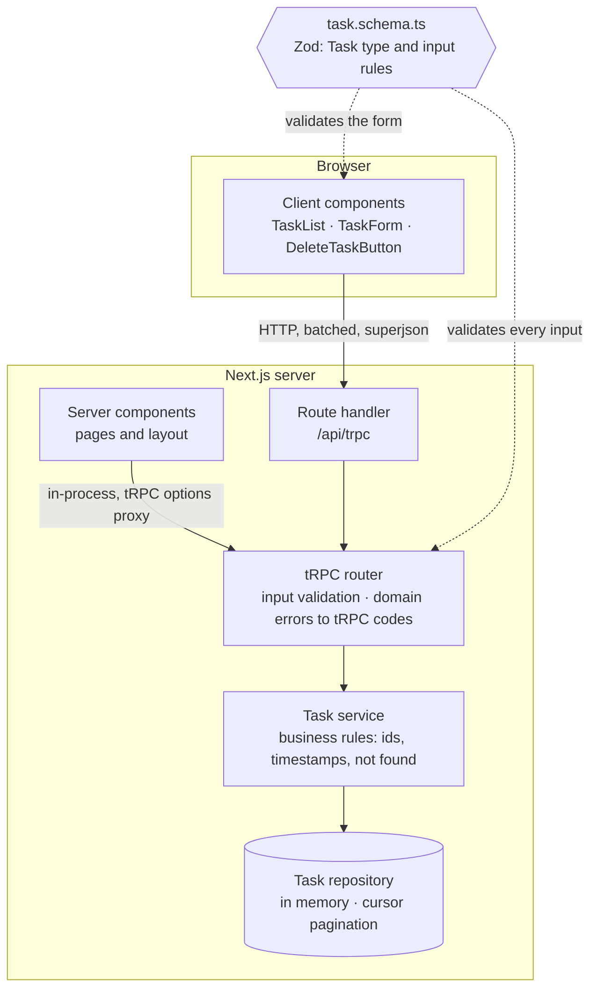

# Task Manager

A small task manager built with **Next.js 15 (App Router)** and **tRPC v11**, keeping tasks in memory.

## Highlights

- **One Zod schema as the source of truth.** The `Task` type, the form and the API all come from [`task.schema.ts`](src/lib/task.schema.ts); the server validates everything again.
- **Server-rendered first page, no API call on load.** Server components call the tRPC router in-process and hydrate React Query, so the list is visible before any JavaScript runs.
- **Cursor (keyset) pagination with infinite scroll.** Creating or deleting tasks between page loads never duplicates or skips one.
- **Explicit states everywhere:** loading, empty, pending, success and error, plus protection against double submissions.
- **33 tests (20 unit, 13 end-to-end), checked by breaking the code on purpose** to prove they fail when they should. See [Testing](docs/testing.md).

## Getting started

Requires **Node.js 22.12+** (required by the test tooling) and npm.

```bash
npm install
npm run dev            # http://localhost:3000 (redirects to /tasks)
```

Production build:

```bash
npm run build && npm start
```

With Docker instead of a local Node.js install:

```bash
docker compose up --build     # or: docker-compose up --build
# http://localhost:3000
```

The app starts with 25 sample tasks so pagination is visible right away. Data lives in memory and resets on every restart.

| Script                        | What it does                   |
| ----------------------------- | ------------------------------ |
| `npm run dev`                 | Development server (Turbopack) |
| `npm run build` / `npm start` | Production build and server    |
| `npm run check`               | Lint + typecheck + unit tests  |
| `npm test`                    | Unit tests (Vitest)            |
| `npm run test:e2e`            | End-to-end tests (Playwright)  |
| `npm run format`              | Format with Prettier           |

## Challenge requirements

| Requirement                                                         | Where                                                                                                      |
| ------------------------------------------------------------------- | ---------------------------------------------------------------------------------------------------------- |
| Next.js 15 with the App Router                                      | [`src/app`](src/app)                                                                                       |
| tRPC set up and consumed by the frontend                            | [`task.router.ts`](src/server/routers/task.router.ts) · [`src/trpc`](src/trpc)                             |
| Task fields `id`, `titulo`, `descricao`, `dataCriacao`              | [Field mapping](docs/api.md#field-mapping)                                                                 |
| Tasks kept in memory                                                | [`task.repository.ts`](src/server/tasks/task.repository.ts)                                                |
| Create, list, update and delete through tRPC                        | [API](docs/api.md)                                                                                         |
| No task without a title, checked in the form and on the server      | [`task.schema.ts`](src/lib/task.schema.ts) · [Saving a task](docs/architecture.md#saving-a-task)           |
| Meaningful errors, e.g. updating a missing task returns `NOT_FOUND` | [`trpc.ts`](src/server/trpc.ts) · [Validation and errors](docs/api.md#validation-and-errors)               |
| Server-side rendering of the task list                              | [`tasks/page.tsx`](src/app/tasks/page.tsx) · [Loading the list](docs/architecture.md#loading-the-list)     |
| Delete from the list with visual feedback                           | [`delete-task-button.tsx`](src/components/tasks/delete-task-button.tsx)                                    |
| Create and edit form built with functional components and hooks     | [`task-form.tsx`](src/components/tasks/task-form.tsx) (React Hook Form)                                    |
| Error messages from both the backend and the frontend               | [`trpc-error.ts`](src/lib/trpc-error.ts) · [Saving a task](docs/architecture.md#saving-a-task)             |
| Loading, empty, success and failure states                          | `loading.tsx`, `error.tsx`, `not-found.tsx` · [`empty-state.tsx`](src/components/tasks/empty-state.tsx)    |
| Bonus: infinite scroll                                              | [`task-list.tsx`](src/components/tasks/task-list.tsx) · [`use-on-in-view.ts`](src/hooks/use-on-in-view.ts) |
| Bonus: comments and documentation                                   | This README · [`docs/`](docs) · JSDoc on exported APIs                                                     |

## Architecture



Browser calls go through HTTP, while server components call the same router in-process. Both paths run the same validation and error mapping.

More in [Architecture](docs/architecture.md): what runs on the server and on the client, the data flows and the project structure.

## Key decisions

- **In-memory store on `globalThis`**, so the route handler and the server components share one store across module graphs and hot reloads. The `TaskRepository` interface is the seam for a real database.
- **Cursor pagination**, which stays correct while tasks change and maps directly to an indexed SQL query.
- **Double submissions blocked synchronously.** The tRPC batch link could pack a fast double click into one request and save a task twice; a ref guard now ignores the second click.
- **No optimistic updates.** Mutations show an explicit pending state and refresh from the server, so failures can be retried.
- **Not-found pages answer HTTP 200** because the edit route streams its skeleton first; the API keeps returning a semantic 404.

All decisions and their trade-offs are in [Decisions](docs/decisions.md).

## Testing

20 unit tests (Vitest) cover the business rules and the API contract; 13 end-to-end tests (Playwright) cover the user flows on a production build. There are no mocks of our own code, and the suite was validated by injecting bugs and confirming the right tests fail. Details in [Testing](docs/testing.md).

## Scope

**Out of scope:** authentication, rate limiting, persistence, optimistic concurrency, a completion status, internationalization and a Content Security Policy.

**With more time:**

- Persistence with PostgreSQL behind the existing `TaskRepository` interface
- Optimistic concurrency using `updatedAt` as a version
- Authentication and per-user tasks
- A Content Security Policy

## Documentation

- [Architecture](docs/architecture.md): what runs where, data flows, project structure
- [API](docs/api.md): procedures, validation rules, error format, field mapping
- [Testing](docs/testing.md): strategy, principles, injected bugs, how to run
- [Decisions](docs/decisions.md): every design decision and its trade-off
