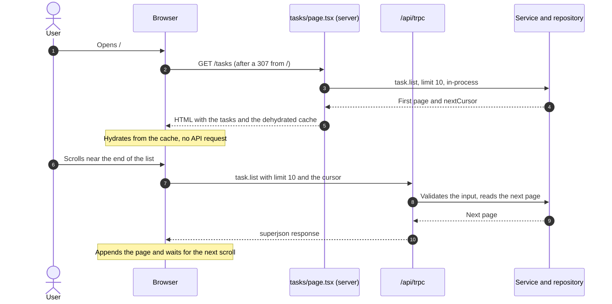
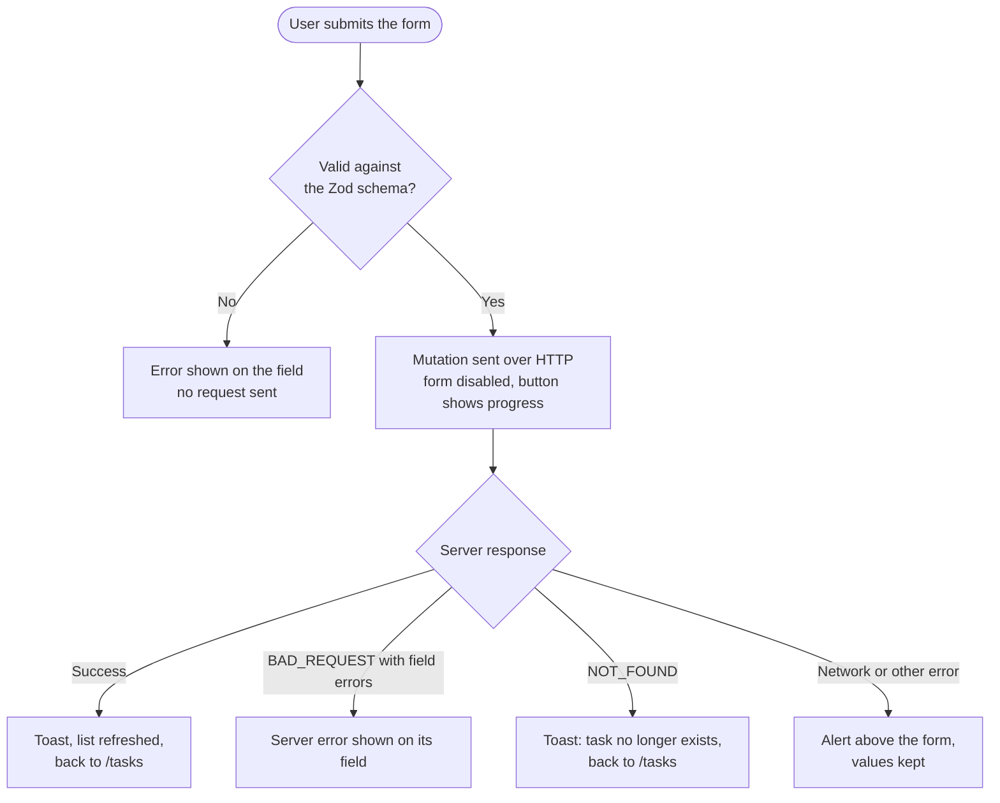

# Architecture

[Back to README](../README.md)

## Overview

The layer diagram is in the [README](../README.md#architecture).

Browser calls go through HTTP, while server components call the same router in-process. Both paths run the same validation and error mapping. One Zod schema, [`src/lib/task.schema.ts`](../src/lib/task.schema.ts), is the source of truth: the `Task` type is derived from it, and the same input schema validates the form and the API.

## What runs where

| Code                                                    | Runs on | Why                                                          |
| ------------------------------------------------------- | ------- | ------------------------------------------------------------ |
| Pages, layout, `loading.tsx`, `not-found.tsx`           | Server  | Fetch data in-process and compose the page; no interactivity |
| `TaskList`, `TaskForm`, `DeleteTaskButton`, `error.tsx` | Client  | Scroll, forms, mutations, dialogs                            |
| `TaskCard`, skeletons, empty state                      | Either  | Purely presentational                                        |

## Data flow

### Loading the list



The first page arrives as HTML, so the list is visible before any JavaScript runs. Each later page is one HTTP request, triggered when the "Load more" button comes within 200px of the viewport. The button stays usable with the keyboard.

### Saving a task



Deleting follows the same idea: the confirmation dialog stays open while the request runs, success and failure are reported with a toast, and a task already deleted elsewhere just refreshes the list.

### Other routes

- **Edit.** The page loads the task in-process and passes it to the form as initial values. Unknown or malformed ids render the not-found page.
- **Navigation.** Each route has its own `loading.tsx` skeleton; `app/tasks/error.tsx` catches unexpected failures with a retry.

## Project structure

```
src/
  app/                 routes (tasks, tasks/new, tasks/[taskId]/edit) and the tRPC route handler
  components/tasks/    task UI; components/ui/ is generated by shadcn/ui
  hooks/               useOnInView (IntersectionObserver)
  lib/                 task schema, client error helpers, formatting
  server/              tRPC setup, routers, task service and repository
  trpc/                React Query + tRPC wiring for the client and the server
tests/                 unit tests (Vitest)
e2e/                   end-to-end tests (Playwright)
docs/                  this documentation
```
